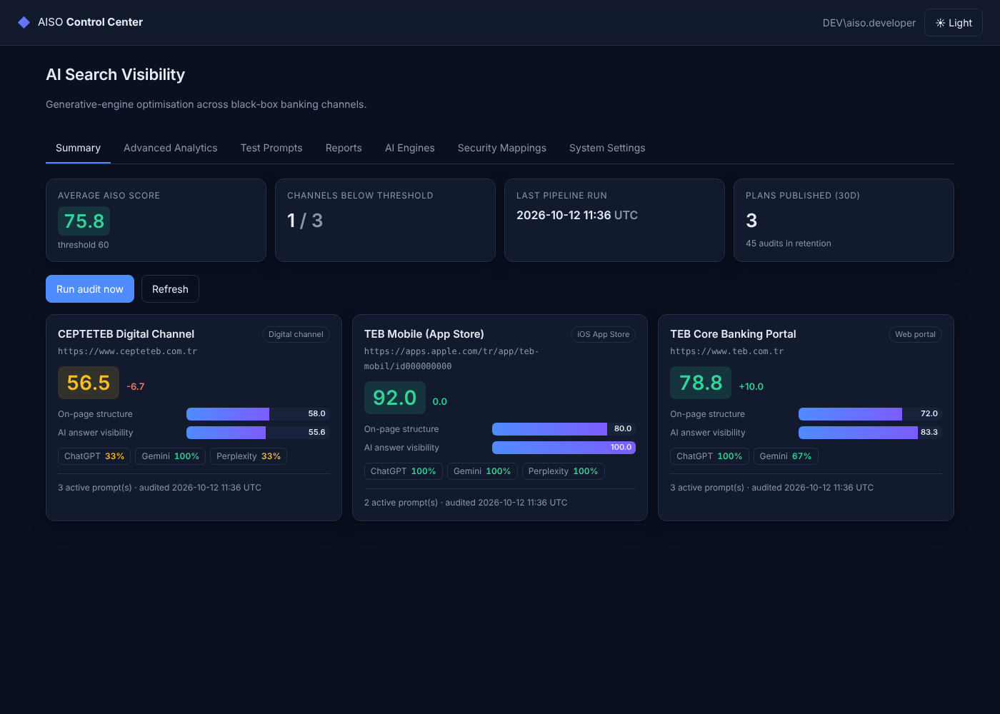
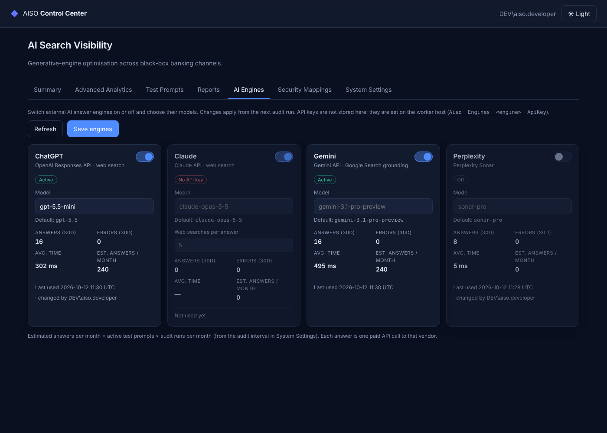

# AISO — AI Search Optimization Platform

An autonomous, database-agnostic, multi-language **AI Search / Generative Engine Optimization (GEO)** platform
built on **.NET 10 + .NET Aspire 13**. It audits external channels as black boxes, measures how visible each
brand is in LLM answers, and uses an on-premises **Claude Code CLI (`claude.exe`)** behind a LiteLLM gateway
to produce language-specific Markdown remediation plans.



## Architecture

```
                 ┌──────────────── Aiso.AppHost (Aspire) ────────────────┐
                 │                                                        │
  SQL Server ◄───┤ sql container ──► aisodb ◄── or ── external Oracle     │
  (container)    │                    │                                   │
                 │   migrations ──────┤ (run-to-completion: MigrateAsync + seed)
                 │        │ WaitForCompletion                             │
                 │   ┌────┴─────┐                                         │
                 │   web        worker ──► claude.exe -p (stdin prompt) ──┼──► LiteLLM gateway ──► internal model
                 │ (Blazor)       │  ▲                                     │
                 └────────────────┼──┼─────────────────────────────────────┘
                                  ▼  │ reads
              C:\PROJECTS\LOCAL LLM DEMO\  data\<run>\*.json   reports\*_AISO_remediation_plan.md   CLAUDE.md
```

**Pipeline (one run, every `AuditIntervalHours` or on "Run audit now"):**
1. `NativeHtmlScraperService` fetches each target (no JS) → headings, schema.org JSON-LD, meta, hreflang, App Store rating/price → weighted, explainable on-page score.
2. `AnswerEngineProbe` asks each `AutomatedTestPrompt` (per `LanguageCode`) on every configured **AI answer engine**: ChatGPT (OpenAI Responses + web search),
   Gemini (Grounding with Google Search), Perplexity (Sonar) and Claude (web search tool). The internal model behind the
   LiteLLM gateway is not probed; it only runs `claude.exe` to orchestrate analysis and planning.
   An answer counts as *visible* when it names the brand (culture-aware, Turkish İ/ı safe) **or** cites one of the channel's `OwnedDomains`.
   Engines run in parallel; each engine's prompts run in sequence.
3. Snapshots land in `data/<run>/`; `LiveSearchAuditLog` stores scores (overall = 0.4 × on-page + 0.6 × answer visibility across all engines)
   and `AISO_ENGINE_PROBE` stores every engine answer with its cited sources.
4. `ClaudeCliOrchestrator` runs `claude.exe` in the workspace: *"Analyze the scraped results in data/…"* → JSON contract (see `CLAUDE.md`).
5. `AisoMarkdownExporter` renders a localized checklist to `reports/` (falls back to free-text parsing if a smaller model ignores the contract).
6. `AisoNotificationService` emails an HTML table when a score drops below `VisibilityAlertThreshold`.

`WeeklyLogCleanUpWorker` re-reads `DataRetentionDays` each sweep (every `CleanupIntervalDays`, default 7) and purges with `ExecuteDeleteAsync`.

## Solution layout

| Project | Purpose |
|---|---|
| `Aiso.Domain` | Entities: `TargetProfile`, `AutomatedTestPrompt`, `LiveSearchAuditLog`, `AisoRemediationPlan`, `GlobalSystemSetting`, `SecurityRoleMapping` |
| `Aiso.Infrastructure` | `AisoDbContext` + fluent configs, provider switch, `DatabaseInitializer`, scraper, LLM probe, `ClaudeCliOrchestrator`, exporter, notifications |
| `Aiso.Migrations.SqlServer` / `.Oracle` | Provider-specific migration assemblies, generated from the same model |
| `Aiso.MigrationService` | Aspire run-to-completion node that migrates + seeds |
| `Aiso.Worker` | Pipeline scheduler, retention sweeper (also installable as a Windows Service) |
| `Aiso.Web` | Blazor Server dashboard, Windows auth + UI-managed AD group → role mapping |
| `Aiso.AppHost` / `Aiso.ServiceDefaults` | Aspire topology, OpenTelemetry, health checks |
| `tests/Aiso.Tests` | 62 tests incl. schema portability, CLI process piping, each engine's request/response format, end-to-end pipeline on SQLite |

## Running

```bash
# Development (cloud or laptop): SQL Server container + all nodes
dotnet user-secrets --project src/Aiso.AppHost set Parameters:sql-password '<strong password>'
dotnet user-secrets --project src/Aiso.AppHost set Parameters:llm-api-key '<gateway key>'
dotnet run --project src/Aiso.AppHost
```

In `Development`, the web UI uses a stub authentication handler (`Aiso:Security:UseDevelopmentAuthentication`)
that signs in a fake user with configurable AD group claims; it **refuses to start** in any other environment.

### On-premises transfer

1. Copy the repository into `C:\PROJECTS\LOCAL LLM DEMO` (the root `CLAUDE.md` is the agent's workspace rule file).
2. Install Claude Code so `claude.exe` is on `PATH` (or set `Aiso:ClaudeCli:ExecutablePath`).
3. Provide secrets as environment variables — never in `appsettings.json`:
   `Aiso__Llm__ApiKey`, `ConnectionStrings__aisodb`, optional `Aiso__Smtp__Username/Password`.
4. Run `.\scripts\smoke-test.ps1` (checks SDK, workspace, `claude.exe` through the gateway, migrations, schema).
5. Run under Aspire, or publish `Aiso.Web` to IIS/Kestrel and install `Aiso.Worker` as a Windows Service.
   The worker must run on the host (not in a container) so it can start `claude.exe`.

### Switching to Oracle

Set `Aiso:Database:Provider=Oracle` (AppHost and services) and `ConnectionStrings:aisodb`
(`User Id=…;Password=…;Data Source=host:1521/SERVICE`). Under Aspire the SQL container is then replaced
by an external connection string. `Aiso:Database:OracleCompatibilityVersion` = 19 or 23.

Portability is enforced, not hoped for: client-generated GUID v7 keys (no identity/sequence), a GUID
concurrency stamp instead of `rowversion`, enums as bounded strings, UTC `DateTime` converters, explicit
`NCLOB` for unbounded text on Oracle, and an UPPER_SNAKE naming convention capped at 30 characters. Tests
fail if either provider's migrations drift from the model or any identifier exceeds the Oracle limit.

## Configuration

| Key | Default | Notes |
|---|---|---|
| `Aiso:Llm:BaseUrl` | `https://teb.com.tr` | LiteLLM gateway (Anthropic-compatible), used only by `claude.exe` for orchestration |
| `Aiso:Llm:Model` | `claude-3-5-sonnet-20241022` | Gateway alias; also pinned for every Claude Code model tier |
| `Aiso:Engines:{key}:ApiKey` | – | Secret per engine (`chatgpt`, `gemini`, `perplexity`, `claude`); an engine without a key is skipped |
| `Aiso:Engines:{key}:Model` | see `Aiso.Worker/appsettings.json` | Vendor model ID. **Confirm against each vendor's current model list** |
| `Aiso:Engines:{key}:BaseUrl` | vendor endpoint | Point at a LiteLLM pass-through route to keep all traffic on the corporate gateway |
| `Aiso:MaxParallelEngines` | `5` | Engines queried at the same time |
| `Aiso:ClaudeCli:ExecutablePath` | `claude.exe` | |
| `Aiso:ClaudeCli:AllowedTools` | `Read, Glob, Grep` | Least privilege; `Bash`, `WebFetch`, `WebSearch` always denied |
| `Aiso:ClaudeCli:ExtraCaCertificatePath` | – | Corporate root CA → `NODE_EXTRA_CA_CERTS` |
| `Aiso:Workspace:RootPath` | `C:\PROJECTS\LOCAL LLM DEMO` | |
| `Aiso:Database:Provider` | `SqlServer` | `SqlServer` \| `Oracle` |
| `Aiso:Smtp:*` | disabled | Internal relay; integrated auth if no username |
| `Aiso:Security:LdapDomain` | – | Linux hosts only: resolve AD groups via LDAP |

Runtime settings (retention, thresholds, recipients, intervals, default theme) live in `AISO_SYSTEM_SETTING`
and are edited from the dashboard.

### AI Engines tab (administrators)



Administrators switch each external engine on or off and override its model (and, for Claude, web searches per
answer) without a restart; changes apply from the next audit run. The worker registers every configured engine in
`AISO_ANSWER_ENGINE` when it starts and on each run, reporting whether it has an API key. A worker restart never
overwrites an administrator's choices. API keys are deliberately **not** stored in the database or entered in the
UI: they stay in the worker's secret store / environment, and the tab shows *No API key* until one is set.
The tab also shows each engine's answers, errors and average response time over 30 days, and the estimated paid
calls per month (active prompts × audit runs per month).

## Deliberate deviations from the original brief

- **CLI syntax.** `claude code "…" --auto-approve` is not a Claude Code command. The orchestrator uses the real
  headless form: `claude -p --output-format json --model … --permission-mode default --allowedTools Read Glob Grep`,
  with the prompt on **stdin** (avoids Windows quoting and the 32K argument limit). The agent is read-only; the
  platform writes all reports, so no auto-approval of edits is needed.
- **Gateway URL.** `https://teb.com.tr` is used as given, but it is also the public portal being audited. Confirm
  this really is the LiteLLM endpoint — sending `ANTHROPIC_API_KEY` to the public web tier would expose the key.
- **Mobile target.** `https://apple.com` is not an app listing; the seed uses an `apps.apple.com/tr/app/…` placeholder
  (`id000000000`) to be replaced with the real App Store ID, editable in the database.
- **Answer engines.** Each public engine is called through its web-search/grounded mode, because that is what consumers see.
  Claude is called through the official Anthropic C# SDK; OpenAI, Gemini and Perplexity over plain HTTP. Default model IDs
  (`gpt-5.5`, `gemini-3.1-pro-preview`, `sonar-pro`, `claude-opus-5-5`) are configuration; vendor line-ups change often.
  Enter the keys with `dotnet user-secrets --project src/Aiso.AppHost set Parameters:chatgpt-api-key <key>` (likewise `gemini-`, `perplexity-`, `claude-`).
  API answers approximate, but do not exactly equal, what each consumer app shows a signed-in user.
